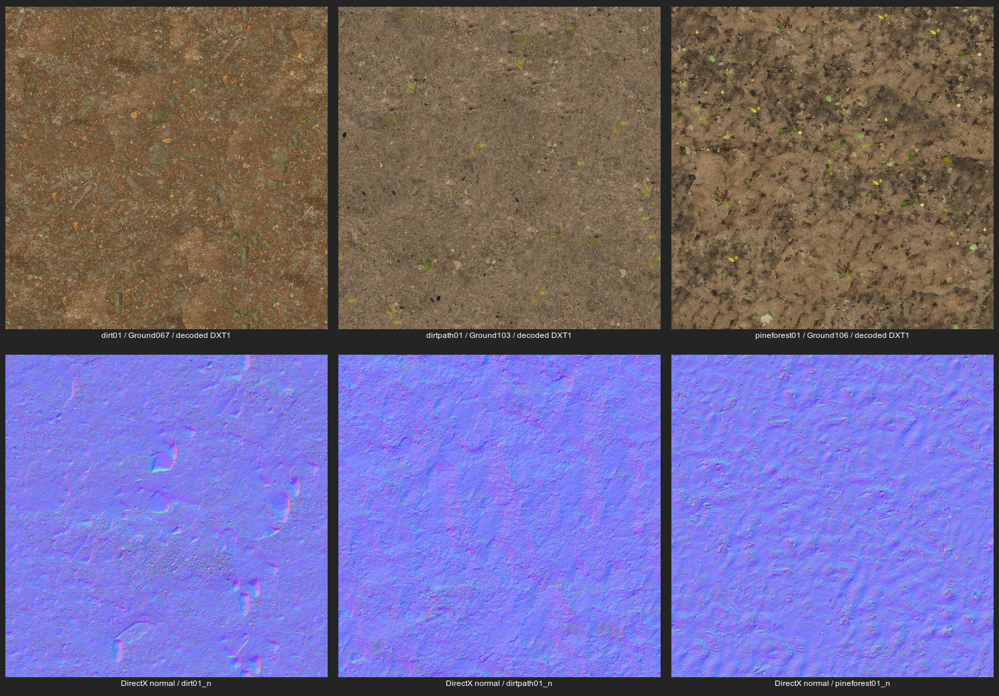

# Modern terrain starter

A small redistributable terrain pack for the original Windows Skyrim runtime on
Apple platforms: three restrained earth/forest surfaces, each with matching
DirectX normal maps. The six actual 2048×2048 DDS files have twelve mip levels and
cost **16,778,064 bytes total**. Their legacy DXT1 format matches the inspected
original targets. The original target headers are 512×512, so these replacements
supply four times the linear resolution and sixteen times the texels per top mip.



This preview is decoded from the shipped DDS top levels. It shows unlit maps,
not a Skyrim screenshot or proof of in-game lighting, UV scale, blending or FPS.
The pack covers `dirt01`, `dirtpath01` and `pineforest01`, plus their `_n` maps.
It does not replace characters, structures, weapons, trees, other terrain or
quests, and it adds no PBR, ray tracing, parallax or emissive functionality.

The encoded previews were reviewed and approved for bundling on
November 16, 2026. Actual gameplay appearance and performance remain untested.

## Bundle and install contract

Bundle **only `pack/`**: manifest.json, payload/ and CREDITS.md. Do not bundle
build archives, scripts, previews, metadata evidence or source-lock files.
Manifest schema 1/id `modern-terrain-v1` declares every lowercase destination,
relative payload file, exact SHA-256 and byte count, 2K dimensions, twelve mips,
DXT1 format and CC0 source URL/ID. The payload is six files, each 2,796,344 bytes.

The Classic/Modern service owns installation and restoration while Skyrim is
closed. It must validate the manifest/header/hash, preserve any pre-existing
loose file, and restore only exactly owned files. This pack's builder never
installs, edits INIs, touches saves or writes into a retail game directory.

## Reproduce

Requires Python 3.11+ and **ImageMagick 7.1.1-47 Q16-HDRI**, the pinned encoder used
for the committed outputs. No compiler, Nexus account, token or paid download is
needed. Other encoder versions may produce different compressed bytes and are
rejected by the builder. The observed host was arm64 macOS.

```sh
python3 modern-visuals/tools/build_pack.py --verify
python3 modern-visuals/tools/build_pack.py --download --out modern-visuals/build/rebuilt-pack --compare-shipped
python3 modern-visuals/tools/test_pack.py
```

The second command downloads three hash-pinned public 2K PNG archives into the
ignored source cache, extracts only the pinned Color/NormalDX members into
scratch space, and builds separately before comparing the complete manifest to
the committed one. Normal PNGs are 16-bit; legacy DXT1 encoding quantizes them to
its RGB block format. All source maps are fully opaque; dropping their redundant
alpha therefore invents no opacity or material channel. Normal Y is already
DirectX in the supplied NormalDX files: it is neither flipped nor swizzled.
All lower normal mips are vector-renormalized; color mips use sRGB transfer math.

Downloads use the official public API's /get URLs with an identifying
SkyrimAppleTerrainBuilder user agent and the material page as ordinary Referer.
The provider redirects to its own CDN. No credentials or website scraping are
used. Archive, source-map and output hashes are pinned; a changed download fails
closed. Raw archives and extracted PNG files are ignored and never committed.

## Provenance and compatibility

- `sources.lock.json`: exact source IDs/URLs, archive and PNG-member hashes.
- `evidence/cc0-provenance.json`: verified primary license/API evidence.
- `evidence/target-header-compatibility.json`: numeric DDS header metadata only.
- `pack/manifest.json`: authoritative output inventory and byte budget.
- `pack/CREDITS.md`: source credit and CC0 links, shipped with the payload.

The optional `inspect_owned_headers.py` reads a locally owned BSA directory and
at most 128 decompressed DDS header bytes per selected target. It outputs only
numeric metadata and never extracts retail pixels. No game archive is required
to rebuild the CC0 pack itself.

Dirt02 and rocks01 were inspected but excluded: their diffuse files are DXT5,
and a header cannot establish the alpha channel's material role. No opaque
replacement or guessed roughness/gloss channel was manufactured. UV atlases,
tree/bark textures and snowy blended materials are also outside this starter.

The payload is derived only from [ambientCG's CC0 materials](https://docs.ambientcg.com/license/),
retrieved through its [official API](https://docs.ambientcg.com/api/v3/assets/).
Builder code follows the repository license; source textures and encoded outputs
remain CC0-1.0.
